# Sutra beta

Releases and tutorials for **Sutra**, one IDE for SwiftUI, Jetpack Compose, Flutter and Compose Multiplatform.

**[Watch the tutorials →](https://anil291987.github.io/sutra-beta/)** Each feature has a short video, recorded in the app, and the steps to try it.
Sutra is in private beta on macOS; builds are published on this repo's Releases page. Sutra's source code is
private; this repo holds what's published from it.

## iOS

Live SwiftUI previews, playgrounds, building to an iPhone with xtool (no Xcode needed), and help with signing and App Store uploads. [All iOS tutorials →](https://anil291987.github.io/sutra-beta/ios.html)

<table>
  <tr>
    <td width="50%" valign="top"><a href="https://anil291987.github.io/sutra-beta/ios.html#swiftui-preview">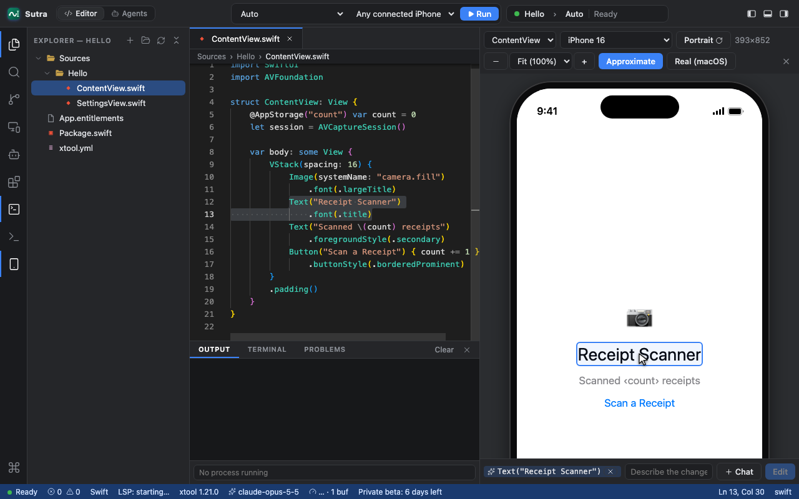</a> <b><a href="https://anil291987.github.io/sutra-beta/ios.html#swiftui-preview">SwiftUI live preview</a></b> See a view beside its code as you type. Click an element in the preview to select its code, and ask AI to change just that element.</td>
    <td width="50%" valign="top"><a href="https://anil291987.github.io/sutra-beta/ios.html#swift-playground">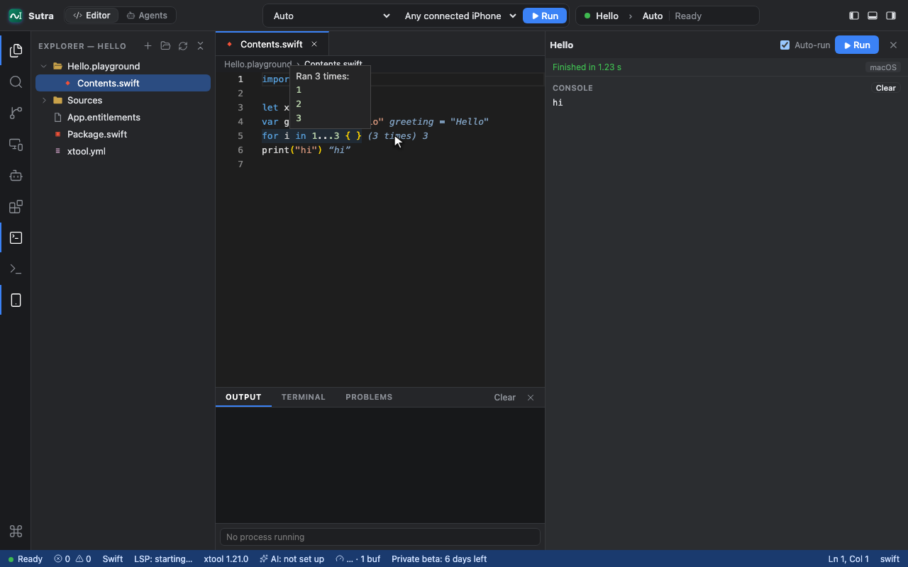</a> <b><a href="https://anil291987.github.io/sutra-beta/ios.html#swift-playground">Swift playgrounds</a></b> Xcode-compatible .playground files, with each line's value beside it and print() output in a console.</td>
  </tr>
  <tr>
    <td width="50%" valign="top"><a href="https://anil291987.github.io/sutra-beta/ios.html#xtool-devices">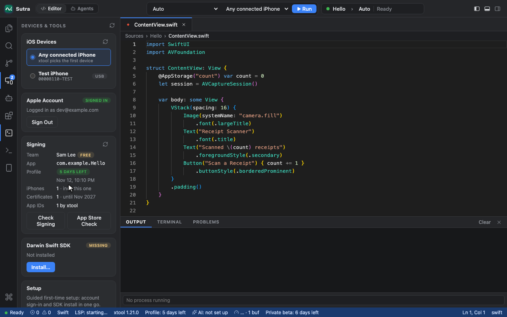</a> <b><a href="https://anil291987.github.io/sutra-beta/ios.html#xtool-devices">Run on iPhone with xtool</a></b> Build, sign and install SwiftPM apps on a connected iPhone with xtool, on macOS, Linux or Windows (WSL). A free Apple ID works.</td>
    <td width="50%" valign="top"><a href="https://anil291987.github.io/sutra-beta/ios.html#signing-doctor">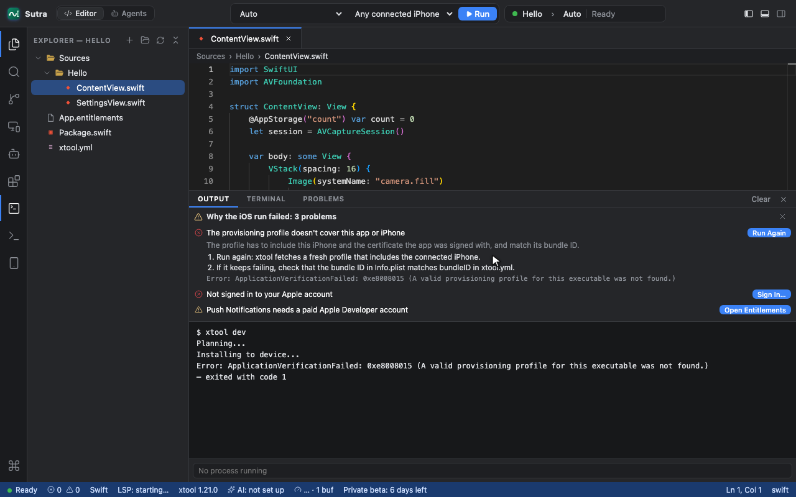</a> <b><a href="https://anil291987.github.io/sutra-beta/ios.html#signing-doctor">Signing Doctor</a></b> When an iPhone run fails to sign, install or launch, Sutra says why in plain words and offers the fix.</td>
  </tr>
  <tr>
    <td width="50%" valign="top"><a href="https://anil291987.github.io/sutra-beta/ios.html#app-store-check">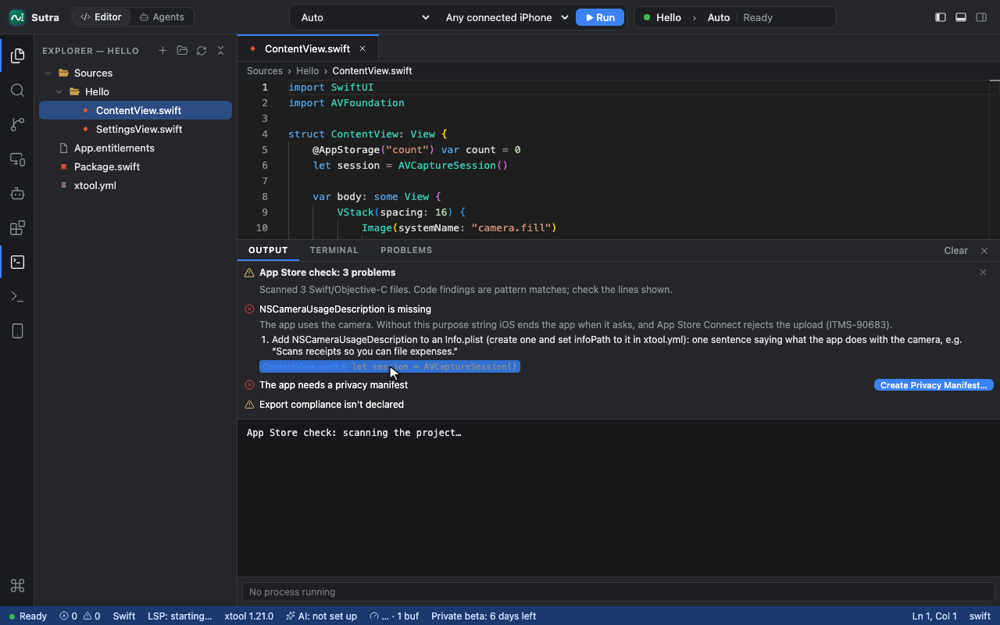</a> <b><a href="https://anil291987.github.io/sutra-beta/ios.html#app-store-check">App Store readiness</a></b> Find what App Store Connect or App Review would reject before you upload: missing purpose strings, the privacy manifest, export compliance.</td>
    <td width="50%" valign="top"><a href="https://anil291987.github.io/sutra-beta/ios.html#xcode-debugging">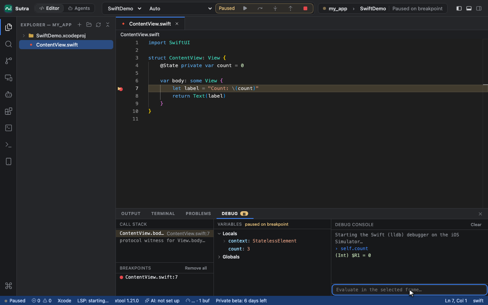</a> <b><a href="https://anil291987.github.io/sutra-beta/ios.html#xcode-debugging">Debug Xcode projects</a></b> Breakpoints, stepping, variables and a console for Swift apps in Xcode projects, on the iOS Simulator or as Mac apps.</td>
  </tr>
  <tr>
    <td width="50%" valign="top"><a href="https://anil291987.github.io/sutra-beta/ios.html#xcode-signing">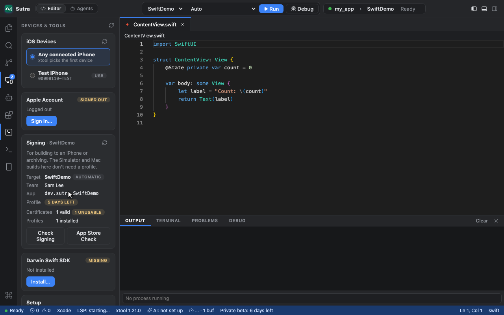</a> <b><a href="https://anil291987.github.io/sutra-beta/ios.html#xcode-signing">Signing for Xcode projects</a></b> Check an Xcode project's signing for iPhone builds and archives: teams, profiles, certificates and entitlements.</td>
  </tr>
</table>

## Android

Compose previews (approximate and on a real device), running on phones and emulators, Kotlin playgrounds, and a stability check for recomposition. [All Android tutorials →](https://anil291987.github.io/sutra-beta/android.html)

<table>
  <tr>
    <td width="50%" valign="top"><a href="https://anil291987.github.io/sutra-beta/android.html#compose-preview">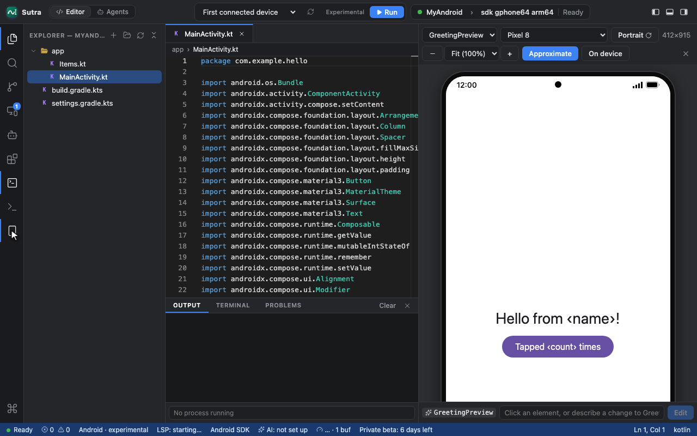</a> <b><a href="https://anil291987.github.io/sutra-beta/android.html#compose-preview">Jetpack Compose preview</a></b> Preview @Preview functions and Activities as you type, on phones, tablets, foldables and dual-screen devices, or render them on a real device.</td>
    <td width="50%" valign="top"><a href="https://anil291987.github.io/sutra-beta/android.html#android-run">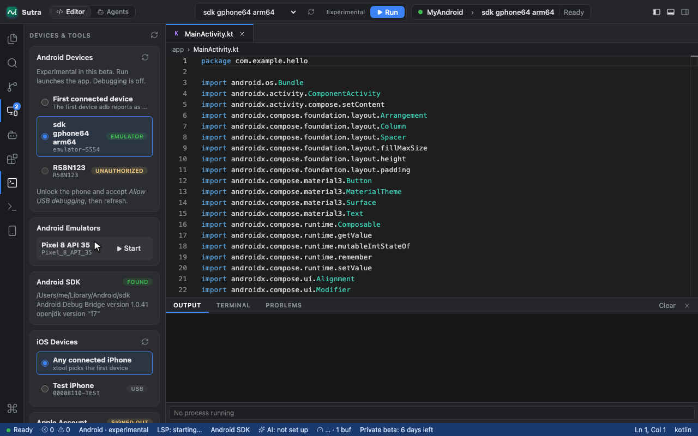</a> <b><a href="https://anil291987.github.io/sutra-beta/android.html#android-run">Run on phones and emulators</a></b> Pick a connected phone or a running emulator and run the app; Devices &amp; Tools starts emulators and checks the SDK.</td>
  </tr>
  <tr>
    <td width="50%" valign="top"><a href="https://anil291987.github.io/sutra-beta/android.html#compose-stability">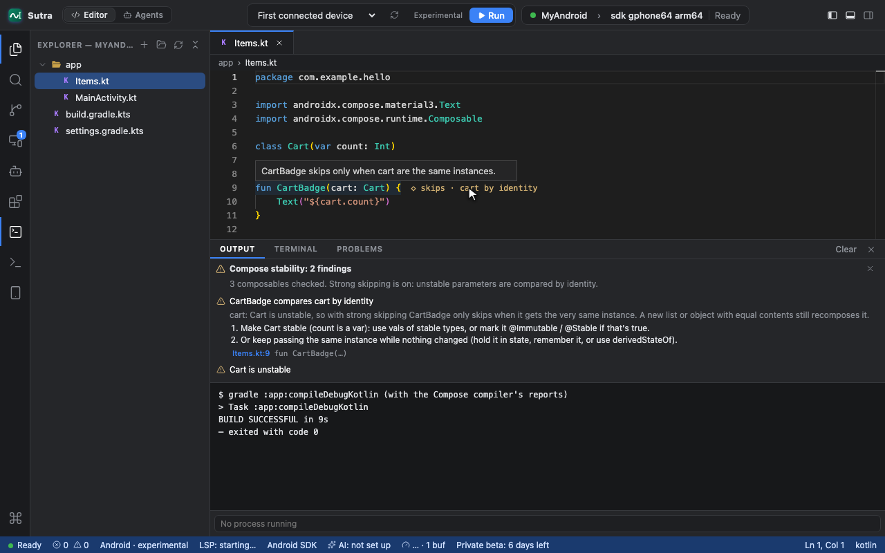</a> <b><a href="https://anil291987.github.io/sutra-beta/android.html#compose-stability">Compose stability check</a></b> Find composables that recompose more than they need to, the unstable classes behind them, and how to fix them, from the Compose compiler's own reports.</td>
    <td width="50%" valign="top"><a href="https://anil291987.github.io/sutra-beta/android.html#kotlin-playground">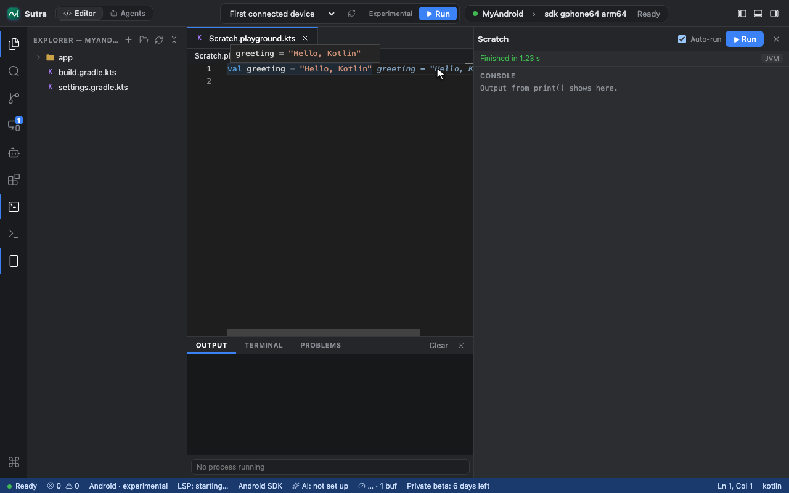</a> <b><a href="https://anil291987.github.io/sutra-beta/android.html#kotlin-playground">Kotlin playgrounds</a></b> Kotlin scripts with each line's value beside it, run on the JVM as you type.</td>
  </tr>
</table>

## Flutter

Live widget previews, a full debugger with hot reload, and widget rebuild counts in the editor. [All Flutter tutorials →](https://anil291987.github.io/sutra-beta/flutter.html)

<table>
  <tr>
    <td width="50%" valign="top"><a href="https://anil291987.github.io/sutra-beta/flutter.html#flutter-debugging">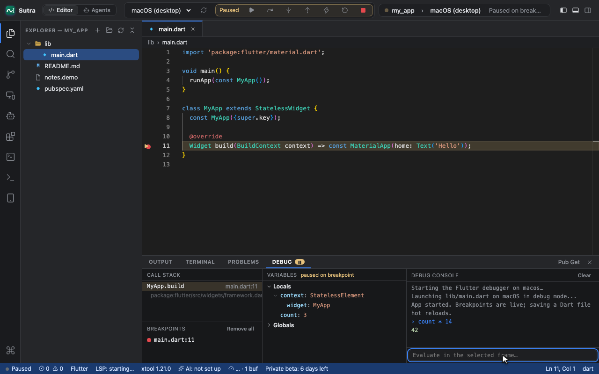</a> <b><a href="https://anil291987.github.io/sutra-beta/flutter.html#flutter-debugging">Debug Flutter apps</a></b> Breakpoints (conditional, and logpoints), stepping, variables, a console, and hot reload on save.</td>
    <td width="50%" valign="top"><a href="https://anil291987.github.io/sutra-beta/flutter.html#flutter-rebuilds">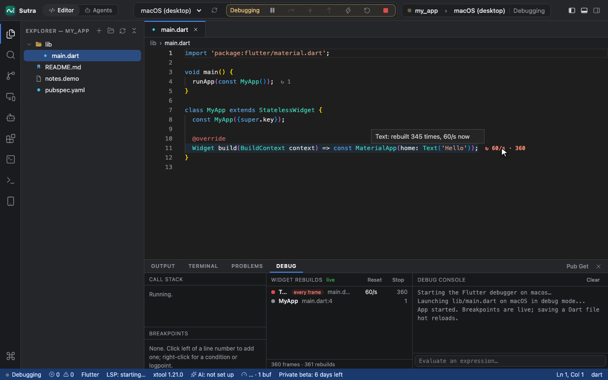</a> <b><a href="https://anil291987.github.io/sutra-beta/flutter.html#flutter-rebuilds">Widget rebuild counts</a></b> See how often each of your widgets rebuilds, beside its line in the editor and in a list of the hottest widgets.</td>
  </tr>
</table>

## Compose Multiplatform

One project for Android, iOS, desktop and web, with previews of shared UI and its resources. [All Compose Multiplatform tutorials →](https://anil291987.github.io/sutra-beta/multiplatform.html)

<table>
  <tr>
    <td width="50%" valign="top"><a href="https://anil291987.github.io/sutra-beta/multiplatform.html#kmp-targets">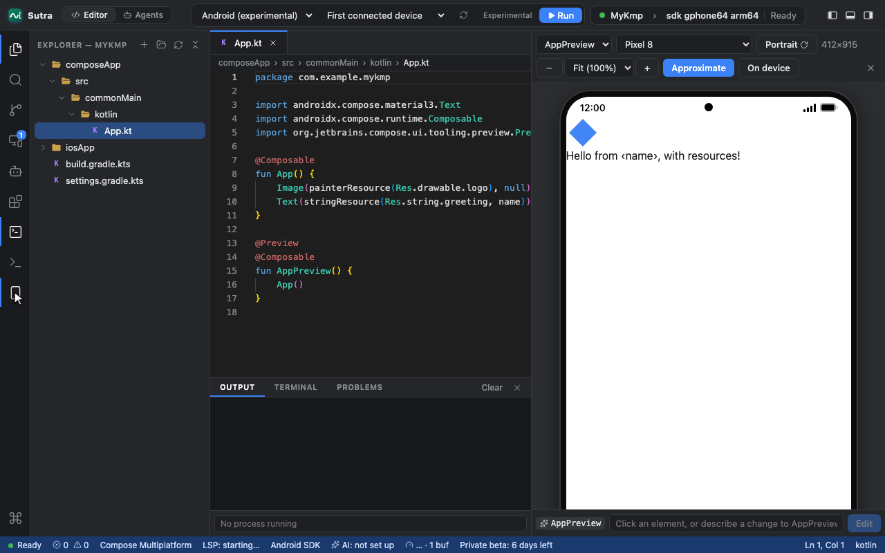</a> <b><a href="https://anil291987.github.io/sutra-beta/multiplatform.html#kmp-targets">Targets and shared previews</a></b> Preview shared composables with their composeResources strings and images, and run the Android, iOS, desktop or web target.</td>
  </tr>
</table>

## Across platforms and AI

Keep your app's platforms in step, and hand work to AI agents you can review. [All Across platforms and AI tutorials →](https://anil291987.github.io/sutra-beta/cross-platform.html)

<table>
  <tr>
    <td width="50%" valign="top"><a href="https://anil291987.github.io/sutra-beta/cross-platform.html#compare-screens">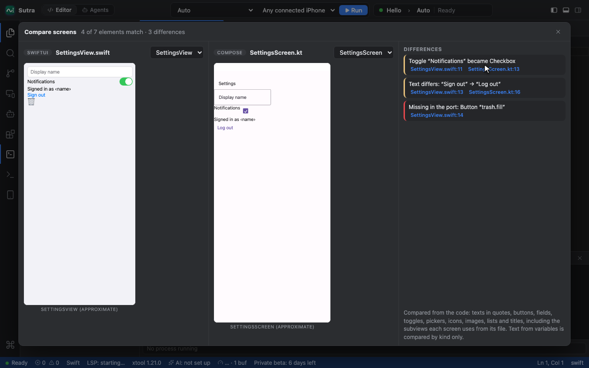</a> <b><a href="https://anil291987.github.io/sutra-beta/cross-platform.html#compare-screens">Compare screens across frameworks</a></b> Compare a screen with its version on your app's other platform: what's missing, texts that changed, components that became others.</td>
    <td width="50%" valign="top"><a href="https://anil291987.github.io/sutra-beta/cross-platform.html#port-screen">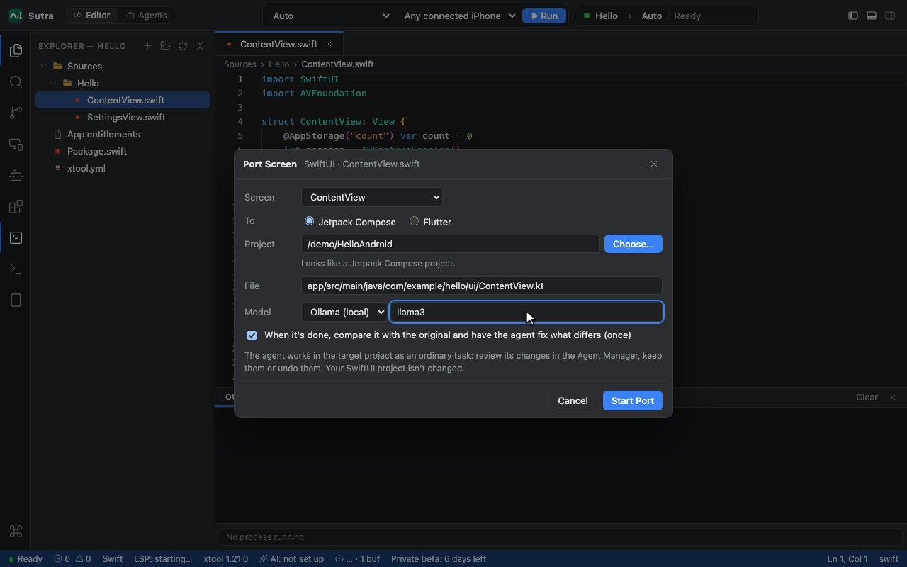</a> <b><a href="https://anil291987.github.io/sutra-beta/cross-platform.html#port-screen">Port a screen with an agent</a></b> An agent ports a screen to another framework in your other project, then Sutra checks the result against the original and has the agent fix what differs.</td>
  </tr>
  <tr>
    <td width="50%" valign="top"><a href="https://anil291987.github.io/sutra-beta/cross-platform.html#agent-manager">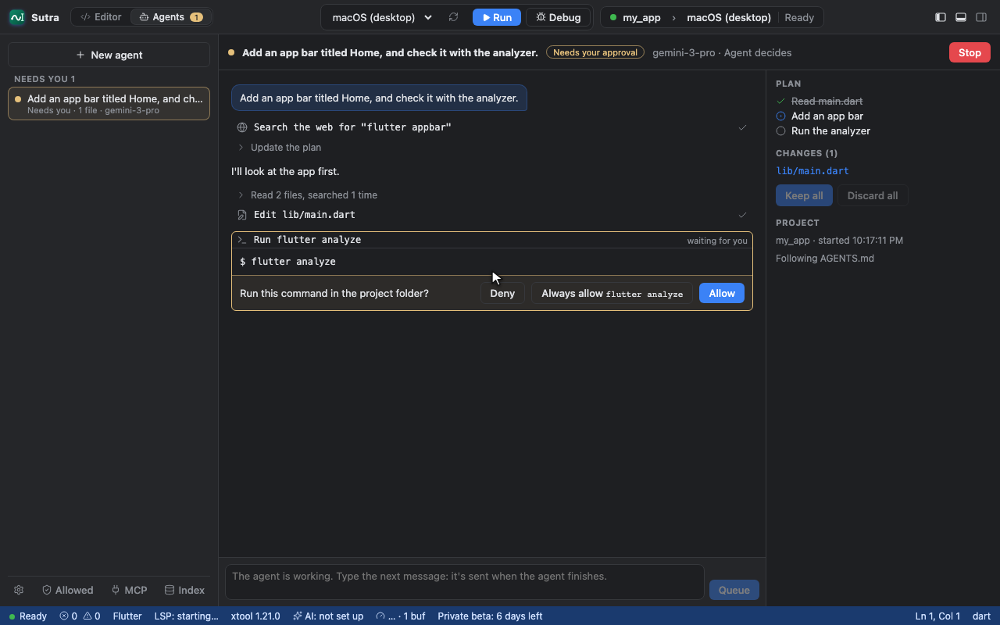</a> <b><a href="https://anil291987.github.io/sutra-beta/cross-platform.html#agent-manager">The Agent Manager</a></b> Hand tasks to AI agents, run several at once, and review their plans, commands and changes before you keep them.</td>
  </tr>
</table>

The videos show Sutra with sample projects. Builds, devices and AI replies in them are simulated, so they always look the same; on your Mac they're real.
